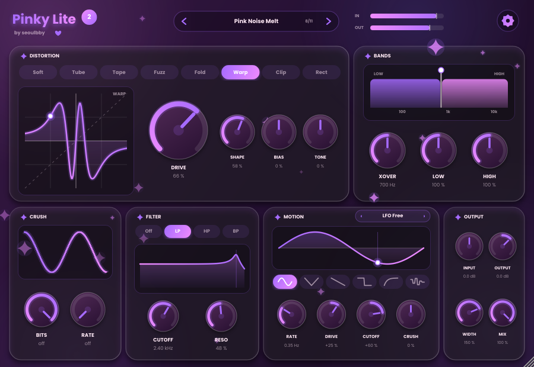

# Pinky Lite 2 

**Wobble · Shimmer · Glass · Glitch — by [seoulbby](https://github.com/seoulbby)**

A pink, animated "melody warper" for any daw
No distortion: instead four ways to bend and sparkle a melody, plus the original Pinky Lite crush + filter.

## Modes
- **Wobble** – dreamy pitch drift (tape wow + flutter) with stereo spread
- **Shimmer** – pitch-shifted reverb: +12 = octave up, -12 = octave down, 0 = plain reverb
- **Glass** – resonators tuned to a *key and scale* (6 scales): notes in your key ring out like glass bells
- **Glitch** – tempo-synced Stutter / Reverse / Tape-stop / Gate / Random with chance and smoothing
  (turn on *Repeatable glitches* in Settings for loops that glitch the same way every time)
- **Crush** (bits + downsample), **Filter** (LP/HP/BP), **Tone** tilt, **Width**, **Mix**, **Input/Output**
- **LFO** (tempo-synced, 6 shapes) that moves Wobble, Shimmer, Glass and the filter cutoff
- 12 factory presets, live visualisers, level meters
- **Settings page** (gear icon): Light/Night theme, 4 accent colours, window size, animation level,
  knob feel, tooltips, repeatable glitches, safety limiter

SEOULBBY / MIENSU 2026 SOFTWARE 
