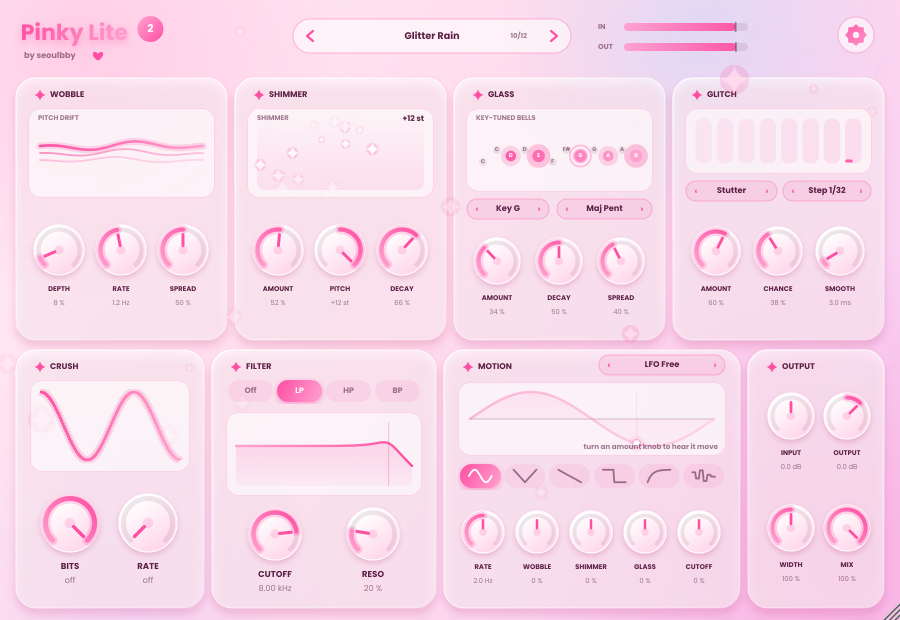
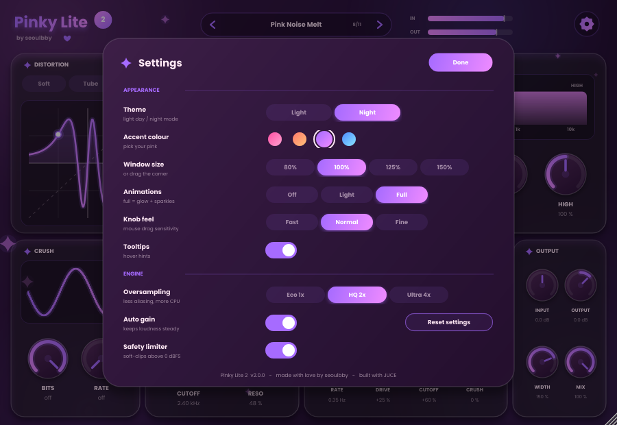

# Pinky Lite 2 💗

**Distortion · crush · filter · motion — by [seoulbby](https://github.com/seoulbby)**

A pink, animated, multi-mode distortion plugin for **FL Studio** (VST3, Windows/macOS) and standalone.
Successor to *Pinky Lite* (crush + filter + mix), rebuilt from scratch with the kind of saturation
you get from ShaperBox / Portal / Autochroma-style tools.

## What's inside
- **8 distortion modes** – Soft, Tube, Tape, Fuzz, Fold, Warp, Clip, Rect, each with *Shape* and *Bias*
- **2-band engine** – Linkwitz-Riley crossover with separate Low / High drive (Autochroma-style colour)
- **Motion** – tempo-synced LFO (1/1 … 1/32, triplets, dotted) with Sine / Tri / Saw / Square / Pump / Random,
  modulating Drive, Filter Cutoff and Crush (ShaperBox-style pumping)
- **Crush** – bit depth + sample-rate reduction
- **Filter** – LP / HP / BP state-variable with resonance
- **Tone** tilt EQ, **Width**, **Mix** (phase-coherent), **Input / Output**
- **Oversampling** Eco 1x / HQ 2x / Ultra 4x with automatic latency compensation
- **11 factory presets**, live transfer-curve / band / filter / LFO displays, level meters
- **Settings page inside the plugin** (gear icon): Light / Night theme, 4 accent colours, window size
  (80–150 % or drag the corner), animation level, knob feel, tooltips, auto-gain, safety limiter.
  Settings are saved with the project *and* remembered for new instances.

Tips: double-click a knob to reset it, mouse-wheel works on knobs, presets, and the LFO sync selector.

## LICENSE 2026 SEOULBBY SOFTWARE / PINKY LITE 
